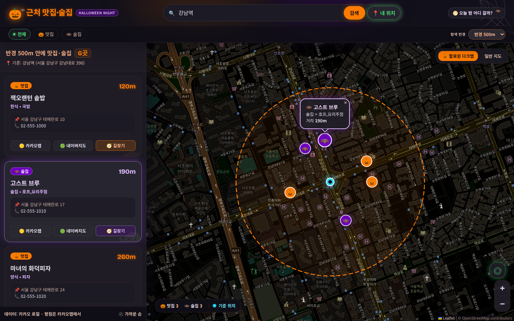

# 🎃 근처 맛집·술집 찾기 (할로윈 에디션)

현재 위치(GPS)나 주소를 입력하면 반경 안의 **맛집·술집**을 지도와 목록으로 보여주는 웹앱입니다.
디자인은 **Google Stitch**로 생성한 할로윈 디자인 시스템("Spooky Night Out")을 적용했습니다.



## 기능
- 📍 **내 위치** 버튼(브라우저 위치 권한) 또는 **주소/장소명 검색** (예: 강남역, 성수동)
- 지도를 클릭해서 기준 위치 바꾸기
- 🎃 맛집 / 🦇 술집 / 전체 필터, 반경 300m ~ 2km
- 가까운 순 목록 ↔ 지도 마커 연동, 카카오맵·네이버지도·길찾기 링크
- 할로윈 다크맵 ↔ 일반 지도 전환, 모바일 반응형

## 실행
Node.js 18 이상만 있으면 됩니다 (npm 패키지 설치 필요 없음).

```bash
cp .env.example .env     # 필요하면 키 입력
npm start                # http://localhost:3000
```

> 📍 위치 기능은 `localhost` 또는 HTTPS에서만 동작합니다 (브라우저 보안 정책).

## 데이터 소스
| 상황 | 사용 API | 비고 |
|---|---|---|
| `.env`에 `KAKAO_REST_API_KEY` 있음 | 카카오 로컬 API | **추천.** 국내 가게 데이터가 가장 풍부함. 검색당 최대 45곳 |
| 키 없음 | OpenStreetMap (Nominatim + Overpass) | 무료, 키 불필요. 국내는 등록된 가게가 적을 수 있음 |

카카오 키 발급: [developers.kakao.com](https://developers.kakao.com) → 내 애플리케이션 → 앱 생성 → **REST API 키** 복사
(제품 설정에서 "카카오맵" 사용 설정을 켜야 할 수 있습니다.)

평점/리뷰는 두 API 모두 제공하지 않아서, 각 가게의 **카카오맵/네이버지도 링크**로 확인하도록 했습니다.

## 디자인 (Google Stitch)
- `design/stitch-halloween.html` — Stitch가 생성한 원본 디자인 HTML
- `design/stitch-render.png` — 원본 디자인 렌더링
- `design/stitch-prompt.json` — 생성에 사용한 프롬프트
- `scripts/stitch.js` — Stitch API(MCP) 호출 CLI. `.env`의 `STITCH_API_KEY` 사용

```bash
node scripts/stitch.js                                   # 사용 가능한 도구 목록
node scripts/stitch.js list_projects
node scripts/stitch.js edit_screens '{"projectId":"...","selectedScreenIds":["..."],"prompt":"..."}'
```

원본 디자인의 색상 토큰·폰트·카드/칩/글로우 스타일을 `public/style.css`에 옮겨 실제 동작하는 앱으로 구현했습니다.

## 구조
```
server.js          # 정적 파일 + /api/geocode, /api/reverse, /api/places (API 키를 브라우저에 노출하지 않음)
public/index.html
public/style.css   # Stitch 디자인 시스템 토큰
public/app.js      # Leaflet 지도, 검색, 목록 렌더링
scripts/stitch.js  # Google Stitch API CLI
design/            # Stitch 결과물 & 스크린샷
```
